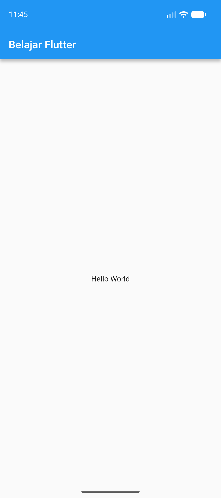
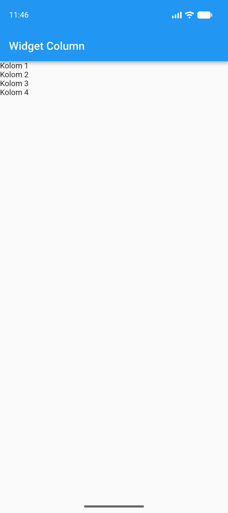
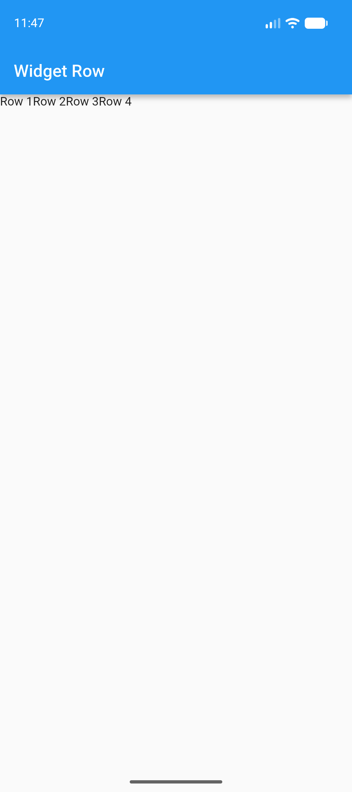
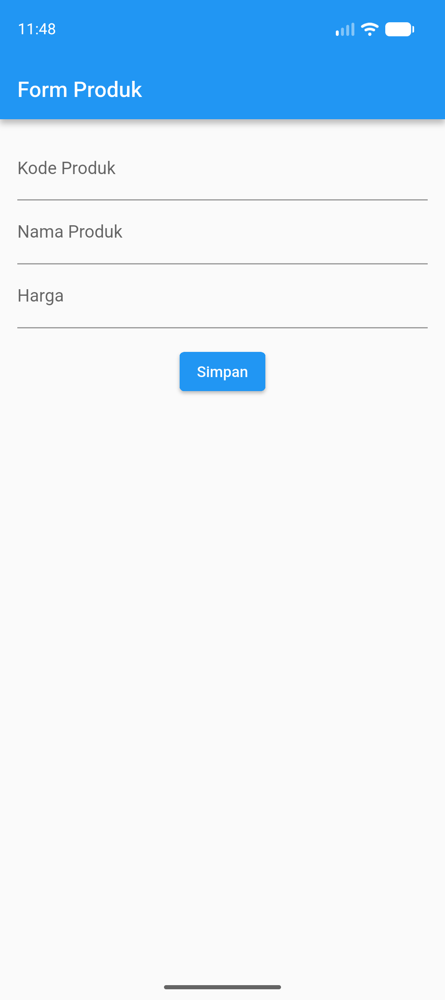
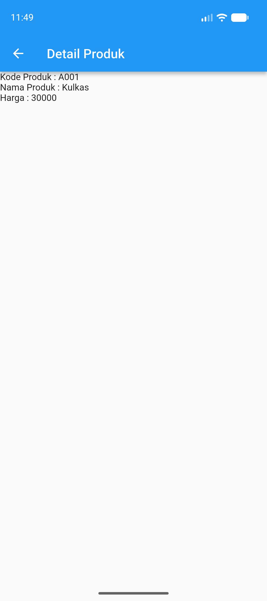
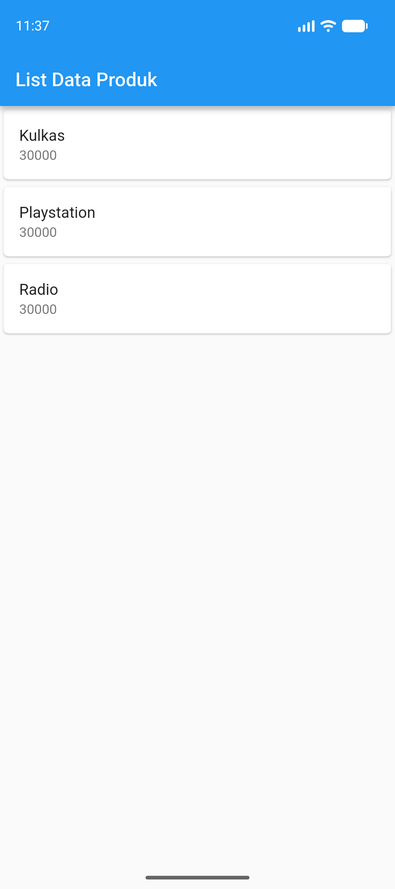

# Praktikum Pemrograman Mobile — Flutter

## Identitas
- **Nama:** Muhammad Yazid Nugraha
- **NIM:** H1D024040
- **Shift KRS:** I

## Modul 2 — Flutter Widget and Design
### Hello World

### Widget Column

### Widget Row

### Form Produk

### Detail Produk

### List Data Produk

## Modul 3 — Routes, Side Menu, Login, dan Local Storage

